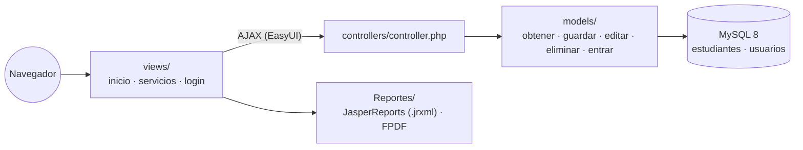

# Visual · CRUD de estudiantes en PHP con reportes

Aplicación web en **PHP 8.1 + MySQL** con patrón MVC sencillo: inicio de sesión, gestión de estudiantes
(listar, crear, editar y eliminar) en una grilla de **jQuery EasyUI** y reportes en PDF con
**JasperReports** y **FPDF**. Proyecto académico (enero de 2025).

## Arquitectura



## Inicio rápido

```bash
docker compose up -d --build
```

- Aplicación: <http://localhost:8080>
- MySQL: `localhost:3306` (credenciales de desarrollo en `docker-compose.yml`; la base se crea con `init.sql`)

La imagen instala Java para ejecutar los reportes de JasperReports (`jdk8.sh` hace lo mismo fuera de Docker).

## Estructura

```
├── controllers/     Controlador único que despacha las acciones
├── models/          Conexión y operaciones sobre la base
├── views/           Páginas (plantilla, inicio, servicios, login…)
├── Reportes/        Plantilla Jasper de estudiantes y generación con FPDF
├── jquery-easyui/   Componentes de interfaz
├── init.sql         Esquema y datos iniciales
└── docker-compose.yml
```

> Las credenciales de `docker-compose.yml` son solo para desarrollo local.
